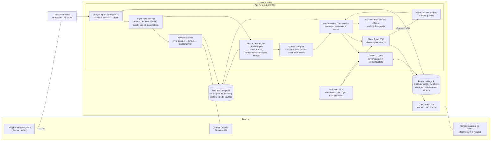
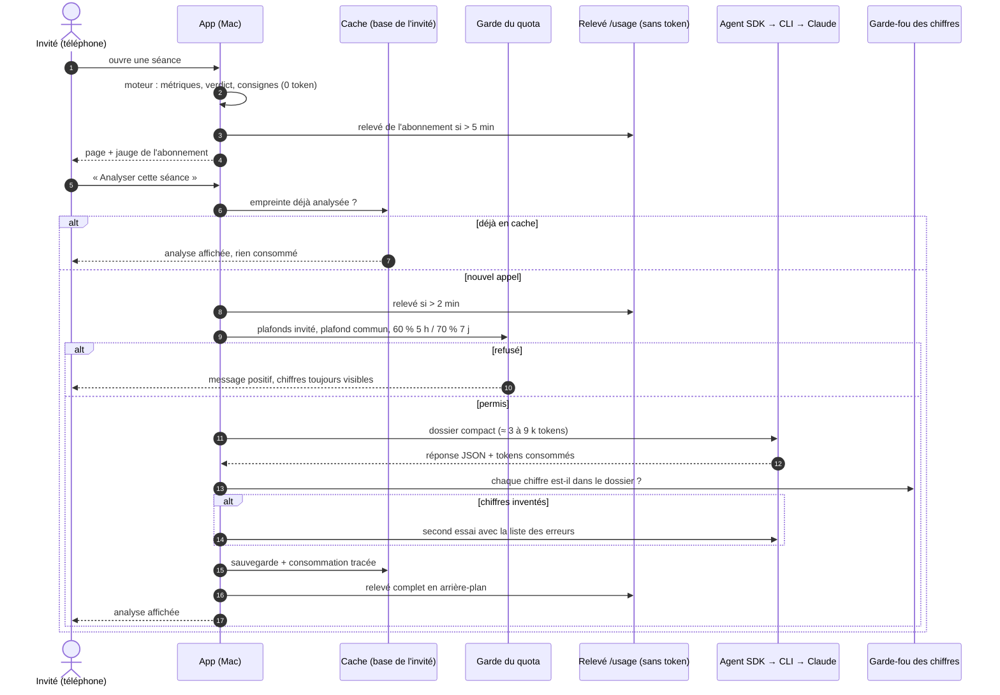
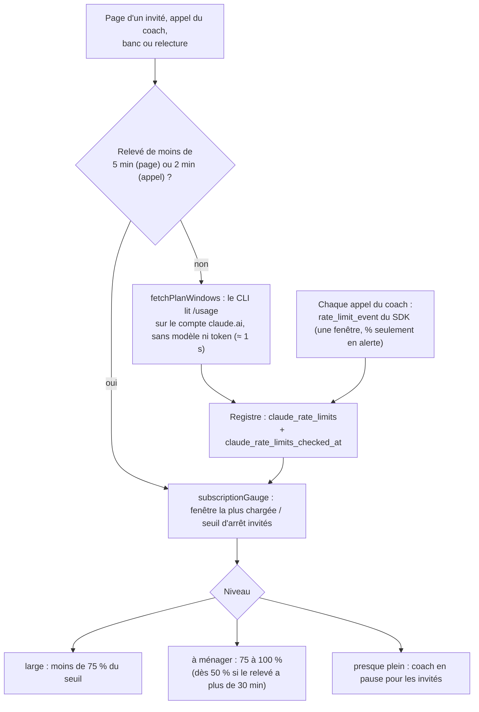

# Comment Sillage fonctionne

Note de fond, à jour au 21 novembre 2026. Les détails de chaque décision sont dans `docs/HANDOFF.md`.

## En une phrase

Tout tourne sur le Mac de Bastien : une app Next.js (`npm start`, 127.0.0.1:3000) lit Garmin, range chaque
profil dans sa propre base SQLite, calcule tout avec un moteur déterministe, et ne demande à Claude (via
l'abonnement claude.ai du Mac, sans clé API) que de **formuler** à partir d'un petit dossier chiffré, sous
contrôle.

## 1. Vue d'ensemble

## 2. Les briques, une par une

| Brique | Ce qu'elle fait | Où |
| --- | --- | --- |
| Accès depuis l'extérieur | Tailscale Funnel publie le Mac sur une adresse HTTPS stable ; l'app n'écoute que 127.0.0.1. | `docs/ACCES.md` |
| Connexion | Lien d'invitation à usage unique ou code ; cookie `sillage_session` par appareil (seule l'empreinte est stockée) ; freinage des essais ratés. Chaque page passe par `asMember` / `asAdmin`. | `src/proxy.ts`, `profiles/request.ts`, `profiles/registry.ts` |
| Registre commun | Liste des profils, sessions, invitations, réglages, plafonds, état de l'abonnement Claude, retours. | `data/sillage.db` |
| Base par profil | Activités, séries, bien-être, objectif, analyses du coach, consommation. Un invité ne voit jamais la base d'un autre. | `db/client.ts` (`getDbFor`), `data/profiles/*.db` |
| Synchro Garmin | Une clé par profil (`GARMIN_API_KEY`, `GARMIN_API_KEY_<ID>`), résumés puis séries détaillées par lots ; toute réponse validée par Zod. | `server/sync-service.ts`, `sync/sync.ts`, `source/garmin/*` |
| Moteur | Tout ce qui est chiffré : type de séance, répétitions, zones, comparables, verdict, consigne « prochaine fois », charge, objectif. Fonctions pures, testées, zéro token. | `src/lib/engine/*`, `server/analytics.ts` |
| Dossier compact | Ce que Claude reçoit : quelques centaines de lignes de synthèse, jamais de séries brutes ni de GPS. | `coach/session-coach.ts`, `outlook-coach.ts`, `chat-coach.ts` |
| Cache | Empreinte (version du prompt + dossier) : une analyse déjà faite ne coûte rien. Jamais d'appel au chargement d'une page, seulement sur bouton (ou après une synchro). | `coach-service.ts`, table `coach_outputs` |
| Garde du quota | Avant tout appel réel : plafonds de l'invité (jour, semaine), plafond commun des invités, et arrêt si l'abonnement de Bastien dépasse 60 % sur 5 h ou 70 % sur 7 jours. Bastien n'a pas de plafond. | `server/quota.ts`, `profiles/quota.ts` |
| Coach | Agent SDK qui pilote le CLI Claude Code du Mac, connecté au compte claude.ai : aucun outil, aucune clé API. Sonnet par défaut (imposé aux invités), Opus pour le bilan, Haiku pour la relecture. | `coach/claude-agent-client.ts`, `coach/index.ts` |
| Garde-fou des chiffres | Chaque chiffre écrit par Claude doit exister dans le dossier ; zone cohérente avec la FC ; pas de cause ni de jugement d'état inventés. Sinon second essai, puis refus (l'analyse chiffrée reste affichée). | `coach/number-guard.ts` |
| Contrôle de cohérence | Règles sur l'analyse affichée (allure facile, type de séance, tutoiement / vouvoiement…). Les écarts vont dans `quality_findings`. | `quality/coherence.ts`, `server/quality-service.ts` |
| Relecture Haiku | Par lot, sur bouton ou la nuit : relit les analyses récentes de tous les profils et note les défauts. Sous les plafonds du travail automatique. | `coach/quality-review.ts`, `server/quality-review-service.ts` |
| Banc de nuit et bilan | Variantes de prompt comparées sur un jeu figé, jugées par Opus ; bilan hebdomadaire Opus. Lancés à la main par Bastien, plafonnés (40 k par nuit, 100 k par semaine, arrêt à 60 % / 70 %). | `src/lib/bench/*`, `scripts/nightly.ts`, `coach/weekly-review.ts` |

## 3. Une analyse demandée par un invité

## 4. La jauge de l'abonnement (corrigée le 21 nov.)

Avant la correction, l'app ne connaissait l'abonnement que par l'événement que le SDK joint à chaque
appel du coach. Cet événement ne porte qu'une fenêtre et ne donne le pourcentage qu'en cas d'alerte ;
la dernière valeur de la semaine datait du 16 novembre et, une fois sa remise à zéro passée, la jauge
retombait sur « large ». Elle ignorait aussi tout ce que Bastien consomme ailleurs (Claude Code, claude.ai).
Désormais, le CLI lit le même relevé que `/usage` (toutes fenêtres, en pourcentage, toute l'utilisation
du compte comprise) sans consommer de quota. API marquée expérimentale par le SDK : si elle cesse de
répondre, la jauge garde le dernier relevé, devient prudente et le dit (« dernier relevé il y a X »).
